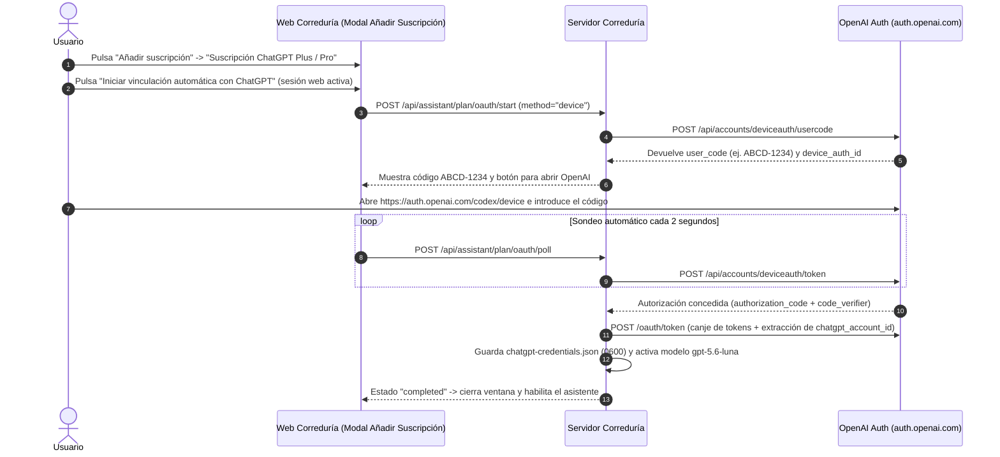

# Manual de Configuración para el Usuario · Plataforma Correduría

Este documento detalla todas las opciones de configuración disponibles en la plataforma de correduría (versión 0.8.2), su propósito, el procedimiento para incorporar credenciales y suscripciones de terceros (suscripción automática de ChatGPT Plus/Pro, APIs de IA, servidores de correo SMTP) y las directrices de buenas prácticas operativas, especialmente en lo relativo a copias de seguridad y su custodia externa.

Para la operativa diaria de cada sección de la interfaz, consulte el [Manual de Usuario](manual-usuario.md).

---

## Índice

1. [Cuenta Local y Seguridad de Acceso](#1-cuenta-local-y-seguridad-de-acceso)
2. [Correo Saliente (SMTP)](#2-correo-saliente-smtp)
3. [Formato y Generación de Códigos de Cliente](#3-formato-y-generación-de-códigos-de-cliente)
4. [Catálogos Propios: Compañías y Tipos de Seguro](#4-catálogos-propios-compañías-y-tipos-de-seguro)
5. [Condiciones de Remuneración (Comisiones)](#5-condiciones-de-remuneración-comisiones)
6. [Política de Vencimientos y Avisos (Notificaciones)](#6-política-de-vencimientos-y-avisos-notificaciones)
7. [Política y Almacenamiento de Copias de Seguridad (Backups)](#7-política-y-almacenamiento-de-copias-de-seguridad-backups)
8. [Proveedor de Inteligencia Artificial y Memoria del Asistente](#8-proveedor-de-inteligencia-artificial-y-memoria-del-asistente)
9. [Canal de Actualizaciones Firmadas](#9-canal-de-actualizaciones-firmadas)
10. [Mantenimiento y Diagnóstico del Sistema](#10-mantenimiento-y-diagnóstico-del-sistema)
11. [Guía Paso a Paso: Credenciales y Autenticación con Terceros](#11-guía-paso-a-paso-credenciales-y-autenticación-con-terceros)
    - [11.1 Servidores de Correo Saliente (SMTP)](#111-servidores-de-correo-saliente-smtp)
    - [11.2 API Keys de Proveedores de IA (OpenAI y compatibles)](#112-api-keys-de-proveedores-de-ia-openai-y-compatibles)
    - [11.3 Suscripción de ChatGPT (Plus / Pro mediante Sign in with ChatGPT)](#113-suscripción-de-chatgpt-plus--pro-mediante-sign-in-with-chatgpt)
12. [Buenas Prácticas de Seguridad y Almacenamiento de Backups](#12-buenas-prácticas-de-seguridad-y-almacenamiento-de-backups)
    - [12.1 El riesgo del almacenamiento único en el miniPC / Raspberry Pi](#121-el-riesgo-del-almacenamiento-único-en-el-minipc--raspberry-pi)
    - [12.2 Dónde almacenar las copias de seguridad (Regla 3-2-1)](#122-dónde-almacenar-las-copias-de-seguridad-regla-3-2-1)
    - [12.3 Custodia de la Clave de Recuperación criptográfica](#123-custodia-de-la-clave-de-recuperación-criptográfica)
    - [12.4 Ensayos periódicos de restauración offline](#124-ensayos-periódicos-de-restauración-offline)
    - [12.5 Seguridad operativa en red y tratamiento de datos](#125-seguridad-operativa-en-red-y-tratamiento-de-datos)
13. [Tabla Cruzada: Configuraciones y Secciones del Manual de Usuario](#13-tabla-cruzada-configuraciones-y-secciones-del-manual-de-usuario)

---

## 1. Cuenta Local y Seguridad de Acceso

La plataforma funciona bajo un modelo monousuario exclusivo. En cada instalación existe una única cuenta que actúa como titular y administradora del sistema.

### 1.1 Configuración de cuenta inicial
* **Ubicación en la interfaz**: Pantalla de primera puesta en marcha (`/#setup=...`).
* **Parámetros configurables**:
  * `Código de instalación`: Token único de un solo uso generado en el servidor mediante el comando `correduria setup-link`.
  * `Nombre del negocio`: Nombre comercial de la correduría (hasta 120 caracteres).
  * `Correo de la cuenta`: Dirección de correo electrónico del corredor que servirá de identificador de acceso y destino de avisos.
  * `Contraseña`: Clave maestra (longitud obligatoria de 12 a 128 caracteres). Se almacena mediante derivación criptográfica robusta (`argon2id`).
* **Referencia en el Manual de Usuario**: [Manual de Usuario · Sección 1.1 (Setup)](manual-usuario.md#11-primera-puesta-en-marcha-setup).

### 1.2 Cambio de contraseña
* **Ubicación en la interfaz**: Pestaña **Configuración** → Tarjeta *Seguridad de su cuenta*.
* **Parámetros**:
  * `Contraseña actual`: Validación de seguridad del titular.
  * `Nueva contraseña` y `Repita la nueva contraseña`: Entre 12 y 128 caracteres.
* **Comportamiento**: Al modificar la contraseña, **todas las sesiones activas en otros navegadores se invalidan automáticamente**.
* **Referencia en el Manual de Usuario**: [Manual de Usuario · Sección 1.2 (Login)](manual-usuario.md#12-inicio-de-sesión-login).

---

## 2. Correo Saliente (SMTP)

Permite que la instalación envíe correos electrónicos para dos funciones exclusivas:
1. Envío del enlace de recuperación de contraseña en caso de olvido.
2. Envío del resumen de vencimientos al propio correo del corredor (si el canal está activado).

> [!IMPORTANT]
> La aplicación nunca envía correos a clientes finales ni asegurados; el único destinatario es la cuenta registrada del mediador.

### 2.1 Parámetros de configuración
* **Ubicación en la interfaz**: Pestaña **Configuración** → Tarjeta *Correo de recuperación*.
* **Campos**:
  * `Servidor SMTP`: Dirección del servidor (p. ej., `smtp.servidor.com`, `smtp.gmail.com`).
  * `Puerto`: Puerto de conexión TCP (típicamente `587` para STARTTLS o `465` para SSL/TLS directo).
  * `Seguridad`:
    * `STARTTLS`: Negociación TLS sobre puerto estándar (587).
    * `TLS directo`: Conexión cifrada nativa desde el inicio (465).
  * `Dirección del remitente`: Correo que aparecerá en el encabezado `From:` (debe coincidir o estar autorizado por el servidor SMTP).
  * `Usuario SMTP`: Nombre de usuario o cuenta de autenticación.
  * `Contraseña del correo`: Clave SMTP o contraseña de aplicación específica. Si se deja vacía al actualizar otros campos, se conserva la clave existente (siempre que no cambie el host ni el usuario).
  * `Su contraseña actual de la aplicación`: Clave de la cuenta local para autorizar la modificación.
* **Acción de verificación**: Botón *Enviar un enlace de recuperación de prueba*. Envía un correo real para validar la configuración antes de guardarla como definitiva.
* **Referencia en el Manual de Usuario**: [Manual de Usuario · Secciones 1.3 (Forgot/Reset) y 5 (Avisos)](manual-usuario.md#13-recuperación-de-contraseña-forgot--reset).

---

## 3. Formato y Generación de Códigos de Cliente

El código de cliente es la clave primaria inmutable que identifica la ficha en toda la aplicación. Permite trabajar de forma seudonimizada en los listados generales sin exponer datos personales.

### 3.1 Parámetros de configuración
* **Ubicación en la interfaz**: Pestaña **Configuración** → Tarjeta *Códigos de cliente*.
* **Campos**:
  * `Modo habitual`:
    * `Automático`: El sistema asigna el código correlativo según el patrón al crear el cliente si se deja vacío.
    * `Manual obligatorio por ficha`: El usuario debe escribir siempre un código único.
  * `Permitir código manual`: Si está marcado (en modo automático), permite al usuario introducir un código a medida opcionalmente; si no se introduce, se aplica la secuencia.
  * `Patrón`: Estructura del código automático. Admite los siguientes tokens dinámicos:
    * `{SEQ:n}`: Contador correlativo rellenado con ceros hasta `n` dígitos (de 1 a 12, p. ej., `{SEQ:6}` produce `000001`).
    * `{DD}`: Día del mes actual (2 dígitos).
    * `{MM}`: Mes actual (2 dígitos).
    * `{YYYY}`: Año actual en 4 dígitos.
* **Patrones preestablecidos en el desplegable**:
  * `{SEQ:8}` (p. ej., `00000001`)
  * `CLI-{SEQ:6}` (p. ej., `CLI-000001`)
  * `{SEQ:6}-CLI` (p. ej., `000001-CLI`)
  * `{DD}{MM}{YYYY}-{SEQ:6}` (p. ej., `16102026-000001`)
  * `{SEQ:6}-{DD}{MM}{YYYY}` (p. ej., `000001-16102026`)
  * `CLI-{YYYY}-{SEQ:6}` (p. ej., `CLI-2026-000001`)
  * `personalizado`: Permite escribir cualquier combinación válida que contenga exactamente un token `{SEQ:n}`.
* **Siguiente secuencia**: Muestra el próximo número correlativo que se asignará. La secuencia es global y acumulativa; no se reinicia ni se modifica al cambiar el patrón.
* **Referencia en el Manual de Usuario**: [Manual de Usuario · Sección 6 (Gestión de Clientes)](manual-usuario.md#6-gestión-de-clientes).

---

## 4. Catálogos Propios: Compañías y Tipos de Seguro

Permite registrar las entidades aseguradoras con las que opera la correduría y las tipologías de seguro (ramos).

### 4.1 Parámetros de configuración
* **Ubicación en la interfaz**: Pestaña **Configuración** → Tarjetas *Compañías propias* y *Tipos de seguro*.
* **Acciones disponibles**:
  * `Añadir`: Permite dar de alta un nuevo nombre (p. ej., «Allianz», «Mapfre», o ramos como «Auto», «Hogar», «Responsabilidad Civil»).
  * `Editar`: Modificar la denominación comercial.
  * `Activar / Desactivar`: Permite ocultar una compañía o ramo de los nuevos desplegables de pólizas sin borrar las pólizas ya existentes.
* **Integridad histórica**: Cada periodo de póliza almacena una copia estática (*snapshot*) del nombre que la compañía y el ramo tenían en el momento de la contratación. Cambiar el nombre en el catálogo no altera retroactivamente las denominaciones de los periodos pasados.
* **Referencia en el Manual de Usuario**: [Manual de Usuario · Sección 7 (Gestión de Pólizas)](manual-usuario.md#7-gestión-de-pólizas-y-periodos).

---

## 5. Condiciones de Remuneración (Comisiones)

Permite crear plantillas de remuneración pactadas con las entidades para asociarlas explícitamente a los periodos de las pólizas.

### 5.1 Parámetros de configuración
* **Ubicación en la interfaz**: Pestaña **Configuración** → Tarjeta *Condiciones de remuneración*.
* **Campos**:
  * `Compañía`: Aseguradora de aplicación.
  * `Ramo`: Tipo de seguro.
  * `Modalidad`:
    * `Porcentaje`: Comisión sobre prima neta (%).
    * `Cantidad fija`: Importe cerrado por póliza.
  * `Valor decimal`: Cifra económica (admite hasta 4 decimales, p. ej., `12.5000` o `35.0000`).
  * `Base / hecho`: Texto explicativo de la base de devengo (p. ej., *«sobre prima neta devengada en cartera»*, *«producción nueva al cobro del primer recibo»*).
  * `Moneda`: Por defecto `EUR`.
  * `Nota de condiciones`: Observaciones adicionales sobre escalados o acuerdos específicos.
* **Comportamiento inmutable**: Al guardar, se genera una nueva versión (`v1`, `v2`, etc.). Las pólizas vigentes que apuntan a una versión anterior no ven alteradas sus condiciones.
> [!NOTE]
> La plataforma almacena y versiona los pactos económicos, pero **no calcula automáticamente recibos ni liquida importes**, evitando liquidaciones presuntivas o erróneas.
* **Referencia en el Manual de Usuario**: [Manual de Usuario · Sección 7 (Pólizas y Periodos)](manual-usuario.md#7-gestión-de-pólizas-y-periodos).

---

## 6. Política de Vencimientos y Avisos (Notificaciones)

Regula cómo se generan las alertas en el sistema y cuándo se despachan los correos electrónicos informativos al corredor.

### 6.1 Parámetros de configuración
* **Ubicación en la interfaz**: Pestaña **Avisos** → Tarjeta *Política de vencimientos y correo*.
* **Campos**:
  * `Revisión habilitada`: Activa o suspende el cálculo de vencimientos por el planificador interno.
  * `Avisos internos`: Si está marcado, genera notificaciones visibles en la interfaz web de la aplicación.
  * `Correo al corredor (activación expresa)`: Casilla para autorizar el envío de correos salientes con el resumen de vencimientos. Por defecto viene **desactivada**.
  * `Días de anticipación`: Plazo previo a la fecha de vencimiento para generar la alerta (por defecto, `30` días).
  * `Días atrasados admitidos para correo`: Margen de días transcurridos tras el vencimiento durante los cuales todavía se admite el envío del aviso si este quedó pendiente (por defecto, `7` días).
  * `Hora mínima de envío automático`: Hora local del servidor (entre 0 y 23) a partir de la cual el planificador intentará el despacho por correo (por defecto, las `9` de la mañana).
  * `Zona del panel/avisos`: Identificador de zona horaria IANA (por defecto, `Europe/Madrid`).
  * `Reanudar entrega después de revisar la restauración`: Esta casilla solo aparece si la instalación procede de la restauración de un backup. Permite al usuario confirmar que ha revisado la cola antes de reactivar los correos.
  * `Contraseña de la aplicación`: Obligatoria para guardar la política.
* **Referencia en el Manual de Usuario**: [Manual de Usuario · Secciones 3 (Resumen), 4 (Calendario) y 5 (Avisos)](manual-usuario.md#5-avisos-y-notificaciones).

---

## 7. Política y Almacenamiento de Copias de Seguridad (Backups)

Configura la ejecución automática de copias de seguridad completas de toda la información del negocio.

### 7.1 Parámetros de configuración
* **Ubicación en la interfaz**: Pestaña **Backups** → Formulario *Guardar política*.
* **Campos**:
  * `Copia diaria habilitada`: Interruptor para activar la ejecución programada diaria.
  * `Hora local (0 a 23)`: Hora a la que se inicia la copia (por defecto, a las `3` de la madrugada).
  * `Zona horaria`: Zona geográfica para el cómputo horario (`Europe/Madrid`).
  * `Destino absoluto en el servidor`: Ruta física completa en el sistema operativo donde se escribirán los ficheros `.crbk` (por defecto, `/var/lib/correduria/backups` en instalaciones con paquete DEB, o `<data_dir>/backups` en desarrollo).
  * `Días de retención`: Plazo de conservación de copias antiguas. Si se establece en `0`, no se realiza purga automática y las copias se conservan indefinidamente.
  * `Contraseña de la aplicación`: Obligatoria para confirmar la modificación.
* **Referencia en el Manual de Usuario**: [Manual de Usuario · Sección 11 (Copias de Seguridad)](manual-usuario.md#11-copias-de-seguridad-uso-del-operador).

---

## 8. Proveedor de Inteligencia Artificial y Memoria del Asistente

El asistente de consulta puede trabajar sin modelo de lenguaje (consulta matemática directa) o conectarse a un proveedor de IA para razonar sobre documentos y pólizas.

### 8.1 Ventana emergente «Añadir suscripción» y protocolos de conexión disponibles
Puede configurar la conexión del modelo desde dos lugares de la interfaz web:
* **Pestaña `Configuración`** → tarjeta **Modelos de IA y Suscripciones** → botón **Añadir suscripción**.
* **Ventana `Consultar asistente`** → tarjeta **Proveedor y memoria** → botón **Añadir suscripción** (o desplegable *Ajustes avanzados de proveedor y memoria*).

Al pulsar **Añadir suscripción**, se abre una **ventana emergente** que permite elegir entre dos modalidades de conexión:

1. **Suscripción ChatGPT Plus / Pro (`openai_chatgpt_plan` — Auth automático recomendado)**:
   * Permite utilizar su suscripción personal o profesional de ChatGPT (**Plus** o **Pro**) sin necesidad de clave API ni saldo adicional de pago por uso.
   * Integra el flujo OAuth automático de OpenCode (`client_id = app_EMoamEEZ73f0CkXaXp7hrann`) y el motor Codex Responses (`https://chatgpt.com/backend-api/codex/responses`).
   * **Se vincula de forma 100 % automática desde la interfaz web**, sin necesidad de usar la consola ni copiar ficheros por SSH (véase el procedimiento paso a paso en la [Sección 11.3](#113-suscripción-de-chatgpt-plus--pro-vinculación-automática-desde-la-web)).
   * Modelos disponibles para la suscripción: `gpt-5.4` (seleccionado automáticamente al vincular), `gpt-5.4-mini`, `gpt-5.3-codex`, `gpt-5.3-codex-spark`, `gpt-5-codex` y `gpt-4o`.
2. **Clave API (`openai_compatible`)**:
   * Utiliza cualquier proveedor que implemente el protocolo estándar de OpenAI (`/v1/chat/completions`).
   * Sirve para la API oficial de OpenAI Platform, Groq, Mistral, o servidores locales autoalojados como **Ollama** o **LM Studio**.
   * Parámetros:
     * `API base URL`: Por defecto `https://api.openai.com/v1`. Para servidores locales en la misma máquina debe ser `http://127.0.0.1:11434/v1` (en loopback se admite HTTP; cualquier acceso de red externa exige obligatoriamente HTTPS).
     * `Modelo servido`: Identificador del modelo (p. ej., `gpt-4o-mini`, `gpt-4o`, `llama3.2`, etc.).
     * `Clave API`: Clave secreta (se almacena cifrada; dejarla vacía preserva la anterior si no cambia la URL).

### 8.2 Alcance y permisos de acceso a datos (Privacidad del Asistente)
* `Proveedor habilitado`: Activa o apaga la conexión con el modelo externo.
* `Alcance: datos de gestión en lectura (vencimientos/pólizas)`: Permite al modelo consultar datos seudonimizados de fechas, aseguradoras y ramos para contestar dudas de agenda. Activado por defecto.
* `Permitir procesamiento documental en este proveedor`: Permite extraer fragmentos de texto de los PDFs de póliza seleccionados para enviárselos al modelo. **Desactivado por defecto**.
* `Permitir historial seleccionado al proveedor`: Permite enviar el contexto de consultas previas al modelo. **Desactivado por defecto**.

> [!CAUTION]
> Que la aplicación se ejecute en un servidor local no hace que el modelo de IA sea local. Si configura un proveedor en la nube (como OpenAI o ChatGPT), la activación de los permisos documentales enviará fragmentos contractuales a los servidores de dicho proveedor.

### 8.3 Memoria histórica
* `Conservar consultas cifradas`: Almacena el texto de las preguntas y respuestas en la base de datos local bajo cifrado AES-256.
* `Retención de memoria en días`: Tiempo de conservación antes de purgar consultas antiguas (`0` = conservar sin purga).
* **Referencia en el Manual de Usuario**: [Manual de Usuario · Sección 10 (Asistente de Consulta)](manual-usuario.md#10-asistente-de-consulta-ia-y-consultas-directas).

---

## 9. Canal de Actualizaciones Firmadas

El sistema dispone de un mecanismo de actualización seguro mediante firmas criptográficas asimétricas Ed25519, garantizando que el servidor solo reciba paquetes oficiales verificados.

### 9.1 Variables de entorno del sistema (`/etc/correduria/application.env`)
Estas opciones se configuran a nivel de servidor por el operador o instalador técnico:
* `CORREDURIA_UPDATE_MANIFEST_URL`: URL HTTPS donde se publica el fichero `manifest.json` del nuevo release (p. ej., en los releases de GitHub del proyecto).
* `CORREDURIA_UPDATE_PUBLIC_KEY_FILE`: Ruta absoluta en el servidor al fichero con la clave pública Ed25519 del distribuidor (p. ej., `/etc/correduria/release-public.key`).
* `CORREDURIA_UPDATE_ENTITLEMENT_FILE`: Ruta absoluta al fichero de derecho de actualización firmado para esa instalación específica (`installation_id`), que delimita el periodo de mantenimiento contratado (p. ej., `/etc/correduria/entitlement.json`).

### 9.2 Descarga y aplicación de paquetes
* Desde la interfaz (pestaña **Mantenimiento**), el usuario puede pulsar *Comprobar actualizaciones* y *Descargar actualización firmada*.
* El paquete descargado se ubica en el área de preparación (`staging`).
* La instalación efectiva en el sistema operativo la ejecuta el operador con permisos de administración (`sudo`) mediante el comando verificado:
  ```bash
  sudo correduria-server update-install \
    --manifest /var/lib/correduria/updates/manifest-<version>.json \
    --package /var/lib/correduria/updates/correduria-local_<version>_<arch>.deb \
    --public-key /etc/correduria/release-public.key \
    --entitlement /etc/correduria/entitlement.json \
    --data-dir /var/lib/correduria
  ```
* **Referencia en el Manual de Usuario**: [Manual de Usuario · Sección 12 (Mantenimiento)](manual-usuario.md#12-mantenimiento-y-diagnóstico-operativo).

---

## 10. Mantenimiento y Diagnóstico del Sistema

Permite monitorizar el estado interno de la plataforma. La mayoría de los datos provienen de la introspección del sistema operativo y de la base de datos:

* `Espacio libre`: Bytes disponibles en la partición de almacenamiento.
* `Permisos`: Comprobación de que `secret.key`, `application.db` y el directorio de datos tienen permisos estrictos (`0600` / `0700`).
* `Origen`: Verifica si la conexión opera bajo HTTPS o si está en HTTP (solo tolerado en `127.0.0.1`).
* **Referencia en el Manual de Usuario**: [Manual de Usuario · Sección 12 (Mantenimiento)](manual-usuario.md#12-mantenimiento-y-diagnóstico-operativo).

---

## 11. Guía Paso a Paso: Credenciales y Autenticación con Terceros

En esta sección se explica detalladamente cómo obtener y trasladar a la aplicación las credenciales o suscripciones exigidas por proveedores externos.

### 11.1 Servidores de Correo Saliente (SMTP)

Muchos proveedores de correo actuales no admiten la contraseña convencional de la cuenta si está activo el doble factor de autenticación (2FA). Es necesario generar una **Contraseña de aplicación**.

#### Ejemplo con Google Workspace / Gmail:
1. Acceda a su cuenta de Google y vaya a **Seguridad** (`myaccount.google.com/security`).
2. Asegúrese de tener activada la *Verificación en dos pasos*.
3. En el buscador superior de la configuración de cuenta, escriba **Contraseñas de aplicaciones**.
4. Cree una nueva contraseña indicando como nombre «Correduría Local».
5. Google mostrará una clave de 16 letras (p. ej., `abcd efgh ijkl mnop`).
6. En la aplicación de Correduría (pestaña *Configuración* → *Correo de recuperación*):
   * `Servidor SMTP`: `smtp.gmail.com`
   * `Puerto`: `587`
   * `Seguridad`: `STARTTLS`
   * `Dirección del remitente`: Su dirección completa de correo de Gmail.
   * `Usuario SMTP`: Su dirección completa de correo de Gmail.
   * `Contraseña del correo`: La clave generada de 16 caracteres (sin espacios).
7. Pulse *Enviar un enlace de recuperación de prueba* para verificar que el correo llega a su bandeja de entrada.

#### Ejemplo con Microsoft 365 / Outlook:
1. Acceda al portal de administración o configuración de seguridad de Microsoft.
2. Genere una contraseña de aplicación específica para SMTP autenticado.
3. En la aplicación:
   * `Servidor SMTP`: `smtp.office365.com`
   * `Puerto`: `587`
   * `Seguridad`: `STARTTLS`
   * `Dirección del remitente` y `Usuario SMTP`: Su cuenta corporativa.
   * `Contraseña del correo`: La contraseña de aplicación.

---

### 11.2 API Keys de Proveedores de IA (OpenAI y compatibles)

Para utilizar modelos a través del protocolo estándar con clave API:

1. **Obtener la clave API**:
   * Si usa **OpenAI**: Acceda a [platform.openai.com](https://platform.openai.com), inicie sesión, diríjase a **API Keys** y pulse *Create new secret key*. Copie el token que comienza por `sk-...`. Asegúrese de tener una tarjeta o crédito prepago asignado en su cuenta de OpenAI.
   * Si usa un proveedor compatible (Groq, Mistral, Together): Acceda a su panel de control y genere una clave API equivalente.
   * Si usa **Ollama en local**: No se requiere clave API (puede escribir cualquier texto, como `ollama`).
2. **Introducir la clave en la ventana emergente «Añadir suscripción»**:
   * En la pestaña **Configuración** (tarjeta *Modelos de IA y Suscripciones*) o dentro de **Consultar asistente**, pulse el botón **Añadir suscripción**.
   * En la ventana emergente, seleccione la tarjeta **Clave API (API Key)**.
   * En `API Base URL`, indique `https://api.openai.com/v1` (o la URL de su servidor local, p. ej., `http://127.0.0.1:11434/v1`).
   * En `Modelo servido por el endpoint`, indique el nombre exacto del modelo (p. ej., `gpt-4o-mini`).
   * En `Clave API`, pegue su token secreto (`sk-...`).
   * Marque los permisos de alcance deseados y pulse **Guardar conexión por API Key** confirmando con su contraseña de la aplicación.
3. **Verificación**: Vaya a la pestaña **Mantenimiento** y pulse *Probar proveedor IA*. La sonda debe confirmar un resultado positivo.

---

### 11.3 Suscripción de ChatGPT (Plus / Pro: vinculación automática desde la web)

Si dispone de una suscripción de pago de ChatGPT (**Plus** o **Pro**) y no desea abonar facturación adicional por consumo de tokens de API, puede vincular su cuenta **automáticamente desde la interfaz web** (integración OAuth estilo OpenCode):



#### Procedimiento automático paso a paso (Recomendado — Sin consola ni SSH):

1. En la aplicación web de Correduría, vaya a la pestaña **Configuración** (tarjeta *Modelos de IA y Suscripciones*) o abra el asistente flotante / **Consultar asistente** y pulse el botón **Añadir suscripción** (o el icono ⚙️ en el chat).
2. En la ventana emergente, asegúrese de que esté seleccionada la opción **Suscripción ChatGPT Plus / Pro**.
3. En **Método de autorización automática**, deje seleccionado **Código web automático (Recomendado · funciona en local o servidor en red)** (o elija *Navegador en este mismo equipo* si está abriendo la web directamente en la misma máquina donde corre el servidor).
4. Pulse **Iniciar vinculación automática con ChatGPT** (se inicia directamente al disponer ya de sesión web activa).
5. La ventana emergente mostrará un **código único de vinculación** (por ejemplo, `ABCD-1234`):
   * Pulse **1. Copiar código**.
   * Pulse **2. Abrir página de autorización de OpenAI** (se abrirá `https://auth.openai.com/codex/device` en una pestaña nueva).
6. En la página de OpenAI, inicie sesión con su cuenta de ChatGPT Plus o Pro, pegue el código y confirme el acceso.
7. **Activación automática**: Sin tocar nada más, la ventana emergente de Correduría detectará en un par de segundos que ha completado la autorización, guardará las credenciales protegidas (`0600`) en el servidor, activará el protocolo de suscripción con el modelo por defecto `gpt-5.6-luna` y cerrará el diálogo mostrándole el aviso de confirmación.
8. **Descarga y conmutación dinámica de modelos**:
   * Directamente en el panel del chatbot (o en la tarjeta de proveedor), pulse el botón **🔄 Modelos** para descargar en tiempo real el catálogo de modelos disponibles para su suscripción (p. ej. `gpt-5.6-luna`, `gpt-5.6-terra`, `gpt-5.6-sol`, `gpt-6-luna`, `gpt-6-sol`, `gpt-6-astra`, `gpt-6.1-sol`, etc.).
   * Seleccione cualquier modelo en el desplegable para cambiar de modelo inmediatamente sin necesidad de introducir contraseñas.
9. **Historial de consultas**: Las consultas y respuestas se almacenan cifradas con la clave de la instalación (`secret.key`). Para consultar el historial en el chat durante su sesión activa, ya no es necesario introducir la contraseña de la aplicación en cada lectura. La contraseña solo se solicita si desea eliminar definitivamente un registro del historial.

#### Desvinculación o revocación
* Para desvincular la cuenta en cualquier momento, pulse el botón **Desvincular cuenta de ChatGPT** (en la pestaña *Configuración* o dentro de *Consultar asistente*). El servidor revocará los tokens ante OpenAI y eliminará el archivo local `chatgpt-credentials.json`.

#### Alternativa opcional por línea de comandos (CLI `chatgpt-login` / `chatgpt-import`)
Si en un entorno sin acceso directo desde la interfaz web un administrador de sistemas prefiere importar manualmente un archivo de credenciales generado por CLI (`correduria chatgpt-login` y `correduria chatgpt-import`), el servidor mantiene compatibilidad total con los comandos detallados en la documentación técnica del Sprint S07.

---

## 12. Buenas Prácticas de Seguridad y Almacenamiento de Backups

La información gestionada por una correduría de seguros incluye datos de alta confidencialidad (documentos identificativos, autorizaciones de corretaje, contratos de seguro y datos de contacto). La custodia de esta información requiere medidas técnicas y organizativas rigurosas.

### 12.1 El riesgo del almacenamiento único en el miniPC / Raspberry Pi

> [!CAUTION]
> El directorio de backup configurado por defecto (`/var/lib/correduria/backups`) es una **zona de preparación técnica (staging)** dentro del propio servidor.
>
> **Una copia de seguridad ubicada en el mismo disco o tarjeta de memoria que la base de datos viva no protege ante:**
> * Avería de hardware o corrupción de la tarjeta MicroSD / disco SSD.
> * Sobretensión eléctrica o fallo de la fuente de alimentación.
> * Robo físico o extravío del miniPC.
> * Daños por siniestros (incendio, inundación en la oficina).
>
> Si el dispositivo físico se daña, **se perderán simultáneamente tanto los datos de producción como todas las copias de seguridad**.

---

### 12.2 Dónde almacenar las copias de seguridad (Regla 3-2-1)

Se recomienda encarecidamente implementar el principio **3-2-1** adaptado al entorno de la correduría:

```
[ Datos Vivos en la Raspberry Pi ]
                │
                ▼ (Backup diario cifrado CRBK1)
       [ Staging Local ] (/var/lib/correduria/backups)
                │
        ┌───────┴────────────────────────┐
        ▼                                ▼
[ Copia en Red Local ]          [ Copia Externa / Fría ]
Servidor NAS o Carpeta          Disco duro externo USB o
compartida de la oficina        Almacenamiento Cloud cifrado
```

1. **3 copias de los datos**: La base de datos viva del servidor, una copia de seguridad en red local y una copia fuera de la sede física.
2. **2 soportes distintos**: No confiar en un único tipo de dispositivo (p. ej., memoria flash del servidor + almacenamiento en disco magnético NAS).
3. **1 copia fuera de la oficina (*off-site*)**: Custodiada en una ubicación física separada o en un servicio cloud cifrado.

#### Opciones prácticas recomendadas para la correduría:
* **Opción A: Almacenamiento NAS en red local separada**:
  * Montar un recurso compartido (NFS o SMB) desde el NAS corporativo hacia un punto de montaje en el servidor (p. ej., `/mnt/nas-backups`).
  * En la pestaña **Backups** de la aplicación, configure como *Destino absoluto en el servidor*: `/mnt/nas-backups`.
  * *Requisito técnico*: El usuario del sistema `correduria-local` debe tener permisos de escritura en esa carpeta y el servicio systemd debe tener declarada la ruta en `ReadWritePaths`.
* **Opción B: Descarga periódica a través de la interfaz web**:
  * Acceda semanalmente a la pestaña **Backups** y pulse **Descargar** sobre la copia más reciente.
  * Mueva el archivo `.crbk` a una unidad USB cifrada (p. ej., mediante BitLocker o LUKS).
* **Opción C: Script automatizado de réplica externa (*Pull-backup*)**:
  * Un equipo secundario o NAS inicia sesión por SSH con permisos restringidos en la Raspberry Pi y extrae los archivos `.crbk` mediante `rsync` hacia su propio almacenamiento seguro.

---

### 12.3 Custodia de la Clave de Recuperación criptográfica

Los archivos de copia de seguridad tienen extensión `.crbk`. Están cifrados mediante el formato seguro **CRBK1** utilizando el algoritmo **AES-256-GCM** autenticado en streaming.

> [!WARNING]
> **Por qué la clave de recuperación NO se almacena dentro del fichero de backup**:
> Si la clave que descifra el backup estuviera dentro del archivo, el cifrado carecería de utilidad. Por diseño de seguridad, la clave de recuperación (`correduria-backup-recovery.key`) se genera de forma independiente.
>
> **Consecuencias de la pérdida de la clave**:
> Si la clave de recuperación se pierde o se borra y la máquina original queda inutilizada, **es matemáticamente imposible descifrar las copias de seguridad**. Ni los desarrolladores del sistema ni ningún software podrán recuperar los datos.

#### Procedimiento de custodia obligatoria de la clave:
1. En la pestaña **Backups**, pulse el botón **Guardar clave de recuperación** e introduzca su contraseña.
2. Se descargará el archivo `correduria-backup-recovery.key`.
3. **Dónde custodiar este archivo**:
   * En el gestor de contraseñas oficial de la correduría (p. ej., adjunto en una entrada protegida de Bitwarden, 1Password o KeePass).
   * En una memoria USB cifrada guardada en la caja fuerte de la correduría.
4. **Regla de oro**: **Nunca almacene la clave de recuperación en la misma carpeta o soporte físico que los archivos `.crbk` descargados**. Deben conservarse por canales independientes.

---

### 12.4 Ensayos periódicos de restauración offline

Una política de copias de seguridad solo es válida si se ha comprobado empíricamente que las copias pueden restaurarse.

#### 1. Ensayo rápido en la interfaz (Sonda mensual):
* Acceda a la pestaña **Mantenimiento**.
* Pulse el botón **Verificar restauración en entorno aislado** e introduzca su contraseña.
* El sistema descomprime temporalmente la última copia, valida la integridad de SQLite, comprueba las huellas de todos los PDFs y elimina el entorno de prueba, informando del resultado sin afectar a la operación del negocio.

#### 2. Procedimiento de simulacro de recuperación en caso de siniestro total (*Disaster Recovery*):
Si el servidor original queda destruido y se dispone de un nuevo equipo con Ubuntu y el paquete de la aplicación instalado:
1. Transfiera la copia de seguridad `backup-fecha-id.crbk` y la clave `correduria-backup-recovery.key` al nuevo servidor.
2. Ejecute el comando de restauración offline indicando un directorio de destino nuevo:
   ```bash
   sudo -u correduria-local correduria-server restore \
     --backup /ruta/externa/backup-20261016T030000-xxxx.crbk \
     --key /ruta/segura/correduria-backup-recovery.key \
     --destination /var/lib/correduria-restored
   ```
3. El comando verificará:
   * Autenticación criptográfica del archivo.
   * Integridad estructural de la base de datos SQLite y claves maestras.
   * Huellas SHA-256 de todos los PDFs almacenados.
   * Invalidación preventiva de sesiones web y tokens anteriores.
4. Una vez validada, detenga el servicio, reemplace el directorio `/var/lib/correduria` por el restaurado y reinicie el sistema:
   ```bash
   sudo systemctl stop correduria-local
   sudo rm -rf /var/lib/correduria
   sudo mv /var/lib/correduria-restored /var/lib/correduria
   sudo systemctl start correduria-local
   ```
5. Acceda a la interfaz web: el sistema mostrará un aviso de **«Entrega de correos pausada tras restauración»** para permitirle revisar la bandeja antes de que se reanuden los envíos automáticos.

---

### 12.5 Seguridad operativa en red, dispositivos móviles y tratamiento de datos

1. **Acceso exclusivo por HTTPS en escritorio, tablet y móvil**:
   * Cuando acceda a la plataforma desde otros dispositivos de la oficina o en movilidad (portátiles, tablets, teléfonos móviles), la conexión debe circular siempre a través de un proxy local con cifrado HTTPS (p. ej., mediante Caddy o Tailscale con certificado TLS). Nunca transmita contraseñas ni descargue ficheros confidenciales por HTTP plano en la red corporativa.
2. **Uso de la seudonimización, Vista 360° y bloqueo inmediato de la Bóveda (`🔒 / 🔓`)**:
   * Acostúmbrese a operar en el día a día utilizando los códigos de cliente tanto en la vista de **Tarjetas** como en **Tabla**.
   * Desbloquee los datos personales (*Ver datos* o *Desbloquear identidad ahora* en la *Vista 360°*) únicamente cuando sea imprescindible para la gestión de un siniestro, emisión o suplemento.
   * Si trabaja desde una tablet o teléfono móvil en presencia de terceros, pulse el botón **Bloquear** en el indicador superior de bóveda (`🔓 CLI-...`) en cuanto termine la consulta para revocar en el acto el permiso temporal de 5 minutos.
3. **Preferencias visuales locales (Modo Claro / Oscuro y Vista de Dispositivo)**:
   * El selector de tema (`🌙 / ☀️`) en la barra superior almacena únicamente la preferencia visual (`light` / `dark`) en el navegador local sin afectar a la configuración del servidor ni exponer datos.
4. **Revisión obligatoria de paquetes de exportación (RGPD)**:
   * Al tramitar una solicitud de portabilidad o acceso generando el archivo `client-data-export.zip`, revise detenidamente su contenido antes de entregarlo al solicitante.
   * El ZIP contiene datos y documentos en texto claro; asegúrese de entregarlo por canales cifrados o con contraseña acordada con el asegurado.
5. **Política de retención de memoria del asistente**:
   * Si utiliza el asistente con regularidad, configure una política de retención en días (p. ej., 90 o 180 días) en lugar de conservar historiales de forma indefinida, en cumplimiento con el principio de minimización de datos del RGPD.

---

## 13. Tabla Cruzada: Configuraciones y Secciones del Manual de Usuario

| Opción de Configuración | Dónde se Configura | Afecta a este Apartado del Manual de Usuario |
|---|---|---|
| **Cuenta local y contraseña** | Setup inicial / Configuración → Seguridad | [Manual Usuario · Sección 1 (Acceso y Seguridad)](manual-usuario.md#1-acceso-y-seguridad-de-la-sesión) |
| **Servidor SMTP (Host, Puerto, TLS, Clave)** | Configuración → Correo de recuperación | [Manual Usuario · Secciones 1.3 (Recuperación) y 5 (Avisos)](manual-usuario.md#13-recuperación-de-contraseña-forgot--reset) |
| **Formato de Códigos de Cliente (Patrón)** | Configuración → Códigos de cliente | [Manual Usuario · Sección 6 (Clientes)](manual-usuario.md#6-gestión-de-clientes) |
| **Catálogo de Compañías Aseguradoras** | Configuración → Compañías propias | [Manual Usuario · Sección 7 (Pólizas) y Secciones 3-4 (Filtros)](manual-usuario.md#7-gestión-de-pólizas-y-periodos) |
| **Catálogo de Tipos de Seguro (Ramos)** | Configuración → Tipos de seguro | [Manual Usuario · Sección 7 (Pólizas) y Secciones 3-4 (Filtros)](manual-usuario.md#7-gestión-de-pólizas-y-periodos) |
| **Plantillas de Remuneración (Comisiones)** | Configuración → Condiciones de remuneración | [Manual Usuario · Sección 7 (Pólizas y Renovación)](manual-usuario.md#7-gestión-de-pólizas-y-periodos) |
| **Política de Notificaciones (Anticipación, Hora)** | Avisos → Política de vencimientos y correo | [Manual Usuario · Secciones 3 (Resumen) y 5 (Avisos)](manual-usuario.md#5-avisos-y-notificaciones) |
| **Política de Backups (Hora, Destino, Retención)** | Backups → Guardar política | [Manual Usuario · Sección 11 (Copias de Seguridad)](manual-usuario.md#11-copias-de-seguridad-uso-del-operador) |
| **Proveedor IA (API OpenAI o ChatGPT Plan)** | Asistente → Proveedor y memoria | [Manual Usuario · Sección 10 (Asistente de Consulta)](manual-usuario.md#10-asistente-de-consulta-ia-y-consultas-directas) |
| **Permisos de datos IA (PDFs, Historial)** | Asistente → Proveedor y memoria | [Manual Usuario · Sección 10.3 (Modalidades de consulta)](manual-usuario.md#103-modalidades-de-consulta) |
| **Memoria histórica y Retención** | Asistente → Proveedor y memoria | [Manual Usuario · Sección 10.5 (Memoria histórica)](manual-usuario.md#105-memoria-histórica) |
| **Canal de Actualizaciones y Entitlement** | `/etc/correduria/application.env` y Mantenimiento | [Manual Usuario · Sección 12.4 (Canal de actualizaciones)](manual-usuario.md#124-canal-de-actualizaciones-firmadas) |
| **Sondas de Mantenimiento (SMTP, IA, Restore)** | Mantenimiento → Comprobaciones | [Manual Usuario · Sección 12.3 (Comprobaciones disponibles)](manual-usuario.md#123-comprobaciones-disponibles-sondas-bajo-demanda) |
